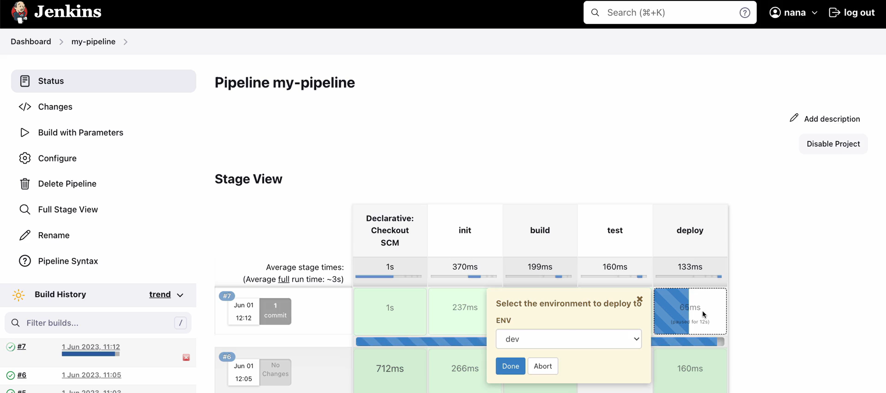
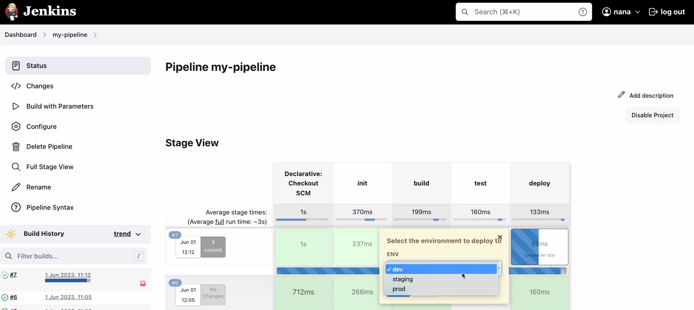
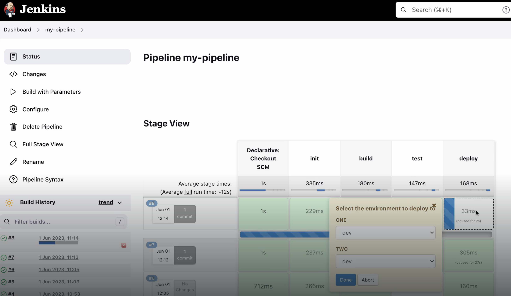

# Module 8: Build Automation & CI/CD with Jenkins
This repository contains all my work, notes, hands‑on exercises, and project files for **Module 8: Build Automation & Continuous Integration / Continuous Delivery (CI/CD) with Jenkins**. The goal of this module is to build a strong understanding of automated build processes, pipeline orchestration, and end‑to‑end CI/CD delivery using Jenkins.

## Notes
<details>

<summary>Intro to Build Automation</summary>
Build automation is a **process that automatically compiles, packages, tests, and prepares software** so developers don’t have to do those steps manually. It’s a core part of modern DevOps and CI/CD pipelines.

Build automation uses tools and scripts to automatically:
- Fetch code from version control
- Compile source code
- Run automated tests
- Package the application (JAR, container image, ZIP etc.)
- Run quality checks (linting, security scans, etc.)
- Produce build artifacts
- Trigger deployments

It replaces manual commands with repeatable, automated tasks.
 


### Why it matters

Build automation helps teams to:

- Eliminate human error
- Ensure repeatability
- Speed up delivery
- Enable CI/CD
- Improve code quality
- Support DevOps at scale

### Common Build Automation Tools

#### General CI/CD

- GitHub Actions
- Jenkins
- GitLab CI
- Azure DevOps Pipelines

#### Language-Specific Build Tools

- Java: Maven, Gradle
- JavaScript: npm, yarn
- Python: pip, tox

</details>

<details>

<summary>Introduction to Jenkins UI</summary>

## Roles for Jenkins

### Jenkins Administrator - Operations or DevOps Teams

- Administers and manages Jenkins
- Setup Jenkins cluser
- Install plugins
- Backup Jenkins Data

### Jenkins User - Developer or DevOps teams

- Creating the actual jobs to run workflows


</details>

<details>

<summary>Docker with Jenkins</summary>

Since Jenkins is running as a Docker container on the host droplet, we need to mount the host machine’s Docker runtime directory into the Jenkins container. This allows Jenkins to execute Docker commands (such as building and pushing images) directly on the host.

</details>

<details>
 
<summary>Freestyle to Pipeline jobs</summary>

### Freestyle jobs
Freestyle jobs are simple, UI‑driven job types designed for executing single steps in the build or deployment process.  
Examples include:  
* Running unit tests
* Building an application
* Deploying artifacts

To create a full workflow, multiple Freestyle jobs often need to be chained together, which becomes difficult to maintain as complexity grows. 

### Limitations of Freestyle jobs
Freestyle jobs have several drawbacks:  
* Limited functionality — best suited for basic tasks
* UI‑based configuration — not easily portable, version‑controlled, or reusable
* Restricted by plugin input fields — reduces flexibility
* Not ideal for complex workflows — complicated pipelines become hard to manage with chained jobs

To address these limitations, Jenkins introduced Pipeline jobs, which offer greater control, flexibility, and maintainability through script‑based configuration.

### Why Pipeline jobs are recommended
Pipeline jobs use Jenkinsfiles, allowing you to:
* Define pipelines as code
* Version‑control your CI/CD workflow
* Reuse and share code easily
* Build complex, multi‑stage pipelines
* Reduce dependency on UI clicks
* Improve reliability and repeatability

</details>
<details>
 
<summary>Jenkinsfile Syntax</summary>

- **Post attribute:**  
    - Execute some logic after all stages executed
    - For example, send an email after build is complete or failed
    
    ```jsx
    pipeline {
      agent any
    
      stages {
        stage("build") {
          steps {
            echo "building the application ..."
          }
        }
    
        stage("test") {
              steps {
                echo "testing the application..."
              }
        }
        
        stage("deploy") {
          steps {
            echo "deploying the application...."
          }
        }
    		post {
    			always {
    			//insert code here
    			}
    			failure {
    			//insert code here
      }
     } 
    }
    ```
    
- **Define conditionals for each stage**
    - You can define conditionals using "when" block
        
        ```jsx
        pipeline {
          agent any
        
          stages {
            stage("build") {
              steps {
                echo "building the application ..."
              }
            }
        
            stage("test") {
                  when {
        	          expression {
        		          BRANCH_NAME == 'dev'
        		          //This branch gets executed when the BRANCH_NAME is dev
        		          }
        		        }  
                  
                  steps {
                    echo "testing the application..."
                  }
            }
            
            stage("deploy") {
              steps {
                echo "deploying the application...."
              }
            }
          }
        }
        ```
        
- **Environmental variables**
    - Jenkins provide a list of environmental variables which can be referenced in your Jenkinsfile script.
    
    ```jsx
    pipeline {
      agent any
      environment {
    	  NEW_VERSION = '1.3.0' // environmental variable
    	}
    	  
    
      stages {
        stage("build") {
          steps {
            echo "building the application ..."
            echo "building version ${NEW_VERSION}" //always needs to enclose in double quotes to access the variable
          }
        }
    
        stage("test") {
              steps {
                echo "testing the application..."
              }
        }
        
        stage("deploy") {
          steps {
            echo "deploying the application...."
          }
        }
      }
    }
    ```
    
- **Using credentials in Jenkinsfile and access them as environmental variable:**
    - Assuming that you saved the desired credentials in Jenkins as ‘server-credentials’ - you can access those credentials in Jenkinsfile by using the withCredentials function shown below
    
    ```jsx
    pipeline {
      agent any
      environment {
    	  NEW_VERSION = '1.3.0' // environmental variable
    	  SERVER_CREDENTIALS = credentials('server-credentials')
    	}
    	  
    
      stages {
        stage("build") {
          steps {
            echo "building the application ..."
            echo "building version ${NEW_VERSION}" //always needs to enclose in double quotes to access the variable
          }
        }
    
        stage("test") {
              steps {
                echo "testing the application..."
              }
        }
        
        stage("deploy") {
          steps {
            echo "deploying the application...."
            withCredentials([
    		        usernamePassword(credentials:'server-credentials', usernameVariable: USER, passwordVariable: PWD))
    		   ]) {
    				    sh "some script ${USER} ${PWD}"
          }
        }
      }
    }
    ```
    
- **Tools attribute**
    - You can access build tools such as Maven, jdk, gradle using the tools attribute.
    
    ```jsx
    pipeline {
      agent any
      tools {
    	 // maven <name of tool configured in Jenkins> 
    	 maven "maven-3.9"
    	} 
      
      environment {
    	  NEW_VERSION = '1.3.0' // environmental variable
    	}
    	  
    
      stages {
        stage("build") {
          steps {
            echo "building the application ..."
            echo "building version ${NEW_VERSION}" //always needs to enclose in double quotes to access the variable
          }
        }
    
        stage("test") {
              steps {
                echo "testing the application..."
              }
        }
        
        stage("deploy") {
          steps {
            echo "deploying the application...."
          }
        }
      }
    }
    ```
    
- **Parameters attribute: Types of parameters include**
    - string (name,  defaultValue, description)
    - choice(name, choices, description)
    - booleanParam(name, defaultValue, description)
    
    ```jsx
    pipeline {
      agent any
      environment {
    	  NEW_VERSION = '1.3.0' // environmental variable
    	}
    	parameters  {
    		string(name:'VERSION', defaultValue:'', description: 'version to deploy on prod')
    		choice(name:'VERSION', choices: ['1.1.0','1.2.0','1.3.0'],description:'')
    		booleanParam(name: 'executeTests', defaultValue: true, description: '') 
    	  }
    
      stages {
        stage("build") {
          steps {
            echo "building the application ..."
            echo "building version ${NEW_VERSION}" //always needs to enclose in double quotes to access the variable
          }
        }
    
        stage("test") {
              when {
    	          expression {
    		          params.executeTests
    		         }
                        
              steps {
                echo "testing the application..."
              }
        }
        
        stage("deploy") {
          steps {
            echo "deploying the application...."
            echo "deploying version {params.VERSION}"
          }
        }
      }
    }
    ```
    
- **Using external Groovy script**
    - Good idea to put multiple scripts into a separate Goovy script to avoid clutter in the Jenkinsfile
    - All environmental variables in Jenkinsfile are available in the groovy script
    
    ```jsx
    // external Groovy script - script.groovy
    
    def buildApp() {
    	 echo "building the application ..."
       echo "building version ${NEW_VERSION}" //always needs to enclose in double quotes to access the variable
    }
    
    def testApp() {
    	echo 'testing the application'
    }
    
    def deployApp() {
    	echo "deploying the application...."
      echo "deploying version {params.VERSION}"
      }
    }
    return this
    ```
    
    ```jsx
    def gv
    
    pipeline {
      agent any
      environment {
    	  NEW_VERSION = '1.3.0' // environmental variable
    	}
    	parameters  {
    		string(name:'VERSION', defaultValue:'', description: 'version to deploy on prod')
    		choice(name:'VERSION', choices: ['1.1.0','1.2.0','1.3.0'],description:'')
    		booleanParam(name: 'executeTests', defaultValue: true, description: '') 
    	  }
    
      stages {
        
    	  stage("init") {
    		  steps {
    			  script {
    				  gv = load "script.groovy"
    				  }
    				 }
    				} 
    			   
        stage("build") {
          steps {
    	      script {
    		      gv.buildApp()
    		      }
    	        
                 }
        }
    
        stage("test") {
              when {
    	          expression {
    		          params.executeTests
    		         }
                        
              steps {
                script {
    	            gv.testApp()
    	            }       
                }
              }
        
        stage("deploy") {
          steps {
    			     script {
    				     gv.deployApp()
            }
        }
      }
    }
    ```
    
- **Input parameter**
    - Typical scenario involves allowing a user to select an environment for deployment after a successful build→run tests→build image→push to private repo stages.
    - Another scenario to allow user to input a version for build
    
    ```jsx
    def gv
    
    pipeline {
      agent any
      environment {
    	  NEW_VERSION = '1.3.0' // environmental variable
    	}
    	parameters  {
    		string(name:'VERSION', defaultValue:'', description: 'version to deploy on prod')
    		choice(name:'VERSION', choices: ['1.1.0','1.2.0','1.3.0'],description:'')
    		booleanParam(name: 'executeTests', defaultValue: true, description: '') 
    	  }
    
      stages {
        
    	  stage("init") {
    		  steps {
    			  script {
    				  gv = load "script.groovy"
    				  }
    				 }
    				} 
    			   
        stage("build") {
          steps {
    	      script {
    		      gv.buildApp()
    		      }
    	        
                 }
        }
    
        stage("test") {
              when {
    	          expression {
    		          params.executeTests
    		         }
                        
              steps {
                script {
    	            gv.testApp()
    	            }       
                }
              }
        
        stage("deploy") {
          input {
    	      message "Select the environment to deploy to"
    	      ok "Done
    	      parameters {
    		      choice(name:'ENV', choices: ['dev','staging','production'],description:'')
    				}
          
          steps {
    			     script {
    				     gv.deployApp()
    				     echo "Deploying to ${ENV}" //local scope only.
            }
        }
      }
    }
    ```
    
    
    
- **To allow multiple input selections (for example, deploy to 2 different systems)**
    
    ```jsx
    def gv
    
    pipeline {
      agent any
      environment {
    	  NEW_VERSION = '1.3.0' // environmental variable
    	}
    	parameters  {
    		string(name:'VERSION', defaultValue:'', description: 'version to deploy on prod')
    		choice(name:'VERSION', choices: ['1.1.0','1.2.0','1.3.0'],description:'')
    		booleanParam(name: 'executeTests', defaultValue: true, description: '') 
    	  }
    
      stages {
        
    	  stage("init") {
    		  steps {
    			  script {
    				  gv = load "script.groovy"
    				  }
    				 }
    				} 
    			   
        stage("build") {
          steps {
    	      script {
    		      gv.buildApp()
    		      }
    	        
                 }
        }
    
        stage("test") {
              when {
    	          expression {
    		          params.executeTests
    		         }
                        
              steps {
                script {
    	            gv.testApp()
    	            }       
                }
              }
        
        stage("deploy") {
          input {
    	      message "Select the environment to deploy to"
    	      ok "Done
    	      parameters {
    		      choice(name:'ONE', choices: ['dev','staging','production'],description:'')
    		      choice(name:'TWO', choices: ['dev','staging','production'],description:'')
    				}
          
          steps {
    			     script {
    				     gv.deployApp()
    				     echo "Deploying to ${ONE}" //local scope only.
    				     echo "Deploying to ${TWO}" //local scope only.
            }
        }
      }
    }
    ```
    
    
- **Another common way to use input attribute is to assign it to the environment variable within the script block**
    
    ```jsx
    def gv
    
    pipeline {
      agent any
      environment {
    	  NEW_VERSION = '1.3.0' // environmental variable
    	}
    	parameters  {
    		string(name:'VERSION', defaultValue:'', description: 'version to deploy on prod')
    		choice(name:'VERSION', choices: ['1.1.0','1.2.0','1.3.0'],description:'')
    		booleanParam(name: 'executeTests', defaultValue: true, description: '') 
    	  }
    
      stages {
        
    	  stage("init") {
    		  steps {
    			  script {
    				  gv = load "script.groovy"
    				  }
    				 }
    				} 
    			   
        stage("build") {
          steps {
    	      script {
    		      gv.buildApp()
    		      }
    	        
                 }
        }
    
        stage("test") {
              when {
    	          expression {
    		          params.executeTests
    		         }
                        
              steps {
                script {
    	            gv.testApp()
    	            }       
                }
              }
        
        stage("deploy") {
                
          steps {
    			     script {
    				     env.ENV = input message: "Select the environment to deploy to", ok "Done", parameters: [choice(name:'ONE', choices: ['dev','staging','production'],description:''))]
    				     gv.deployApp()
    				     echo "Deploying to ${ENV}" //local scope only.
    				     
            }
        }
      }
    }
    ```
</details>  
<details>
<summary>Multibranch Pipeline</summary>


 
</details>


## Projects
1. [Install Jenkins on DigitalOceans](https://github.com/bigtony79/jenkins-docker-digitalocean.git)
2. Create a CI Pipeline with Jenkinsfile (Freestyle, Pipeline, Multibranch Pipeline)
