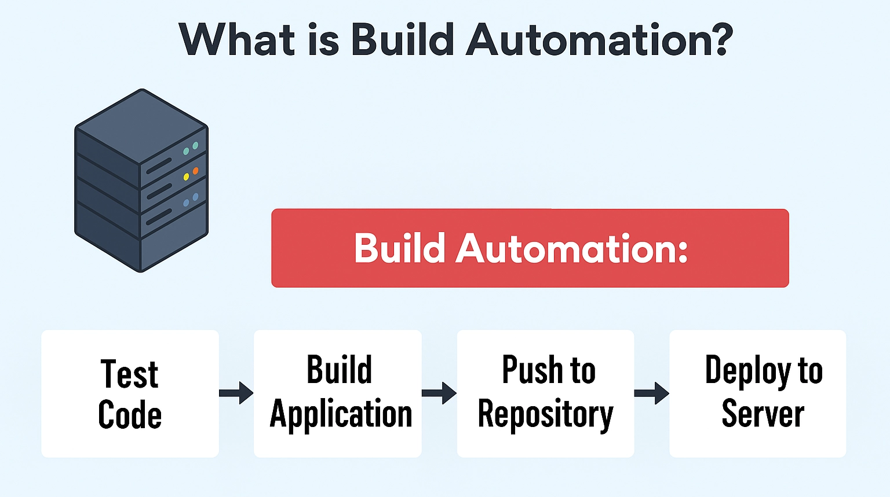

# Module 8: Build Automation & CI/CD with Jenkins
This repository contains all my work, notes, hands‑on exercises, and project files for **Module 8: Build Automation & Continuous Integration / Continuous Delivery (CI/CD) with Jenkins**. The goal of this module is to build a strong understanding of automated build processes, pipeline orchestration, and end‑to‑end CI/CD delivery using Jenkins.

## Notes

Intro to Build Automation

Build automation is a **process that automatically compiles, packages, tests, and prepares software** so developers don’t have to do those steps manually. It’s a core part of modern DevOps and CI/CD pipelines.

Build automation uses tools and scripts to automatically:
- Fetch code from version control
- Compile source code
- Run automated tests
- Package the application (JAR, container image, ZIP etc.)
- Run quality checks (linting, security scans, etc.)
- Produce build artifacts
- Trigger deployments

It replaces manual commands with repeatable, automated tasks.
 

### Why it matters

Build automation helps teams to:

- Eliminate human error
- Ensure repeatability
- Speed up delivery
- Enable CI/CD
- Improve code quality
- Support DevOps at scale

### Common Build Automation Tools

#### General CI/CD

- GitHub Actions
- Jenkins
- GitLab CI
- Azure DevOps Pipelines

#### Language-Specific Build Tools

- Java: Maven, Gradle
- JavaScript: npm, yarn
- Python: pip, tox

Introduction to Jenkins UI

## Roles for Jenkins

### Jenkins Administrator - Operations or DevOps Teams

- Administers and manages Jenkins
- Setup Jenkins cluser
- Install plugins
- Backup Jenkins Data

### Jenkins User - Developer or DevOps teams

- Creating the actual jobs to run workflows

## Projects
1. [Install Jenkins on DigitalOceans](https://github.com/bigtony79/jenkins-docker-digitalocean.git)
